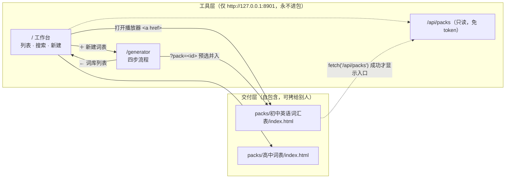
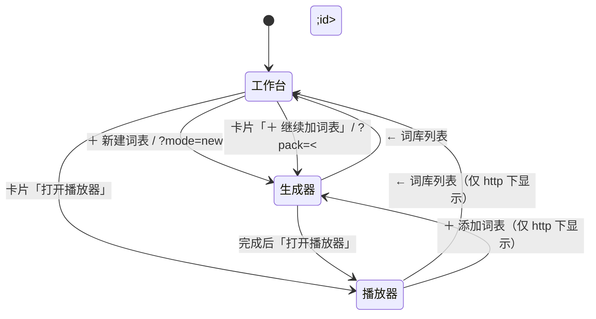

# 词库工作台 · 实施方案 v1.9

> 2026-11-18 · 配套代码：`vocab-tool/home.html`、`serve.py`、`webgen.py`、`generator.html`、`pet-player-sketch/index.html`
> 目标：把「多个词库包 + 生成器」收成一个入口，且**不破坏**"离线包双击即用"。
> 本文档为准 —— 上一轮对话里贴的 `home.html` 片段有 2 处需要按 §5.3 写（v1.1 已采纳）。

## 版本记录

| 版本 | 日期 | 变更 |
|---|---|---|
| v1 | 2026-11-16 | 两层 + 一个工作台；路由表、`/api/packs` 字段契约、四态、门禁 11 条 |
| v1.1 | 2026-11-16 | ① 新增 §8「打包下载」预留位（只留布局槽位 + 接口契约 + 接入点，**不渲染按钮**）② 新增 §9「其它语言词表」结论（三项门槛 / 难度表 / 同形异码 / 单语言包约束）③ §5.3 两处修正标记为**已采纳** ④ §10 门禁补第 11 条「卡片操作区恰好 2 个链接」（原第 11 条「无未捕获异常」顺延为第 12 条）⑤ 原 §8/§9/§10 顺延为 §10/§11/§12 |
| v1.2 | 2026-11-17 | ① 新增 §13「词库管理：重命名 / 删除」（**推翻** §11 里"删除/改名不进 UI"那条）② `/` 改为注入 token（因为它有了写操作）③ §10 门禁：第 11 条拆成「2 链接 + 1 编辑按钮」，新增改名/删除 6 条、移动端无编辑按钮 1 条（共 36 条）④ 说明区去掉 `64ch/76ch` 限宽（行数从 3 → 2）⑤ `packs/` 里三个测试词库（`测试库` / `smoke` / `smoke2`）移入 `work/_trash` |
| v1.3 | 2026-11-17 | ① 包内「添加词库 / 新增页」整块说明删除（折叠标题 / 两段 python 命令 / 两个复制按钮 / 支持格式行），见 §14 ② 顶栏「＋ 添加词表」保留，移动端只留「请在 PC 端上传与生成」③ `_cdp_ui.py` 翻面成反向断言（PC 10 条 / 移动 8 条）④ 模板 `VER` → `v2026-11-17.1`，三个真实包已重渲染（音频数 235 / 58 / 58 未变） |
| v1.4 | 2026-11-17 | ① **列表页最底部那行**草图话术（「生产版要点…不需要一次装载 41.8 MB」）删除；播放页的 `#kernel-note` 与 `.footer-note` 样式**都保留**，见 §14 末补注 ② 模板 `VER` → `v2026-11-17.2`，三个真实包已重渲染（音频数 235 / 58 / 58 未变）③ `_cdp_ui.py` 新增 4 条（PC 2 / 移动 2）：`GONE_NOTE` 独立成组 + `#kernel-note` 仍在（共 22 条，并做过"把字塞回去"的阴性对照） |
| v1.5 | 2026-11-17 | ① 工作台 `/` 换成「词汇讲义」视觉（纸 · 墨 · 荧光笔 · 印章），**只改 `home.html` 的 `<style>`**，DOM / JS / 文案零改动，见 §15 ② `VERSION` → `v2.3.0` ③ hero 三条说明改三列横排、卡片加 4 色书脊、主按钮改实心墨黑、规模行 `tabular-nums`、入场错峰动效（搜索聚焦与 `prefers-reduced-motion` 下关闭）④ `_cdp_home.py` 36 条与 `_cdp_ui.py` 22 条**脚本零改动**通过 |
| v1.6 | 2026-11-18 | ① **词库包内页面**与**生成器**也换成同一套讲义皮肤（`pet-player-sketch/index.html` 的 `<style>`、「＋ 添加词表」侧、`generator.html` 的 `<style>`），见 §16 ② 列表页 `.notice` 从"草图说明"瘦成一句事实；三个模式按钮的 emoji 换内联 SVG（唯一图标级 DOM 微调）③ 包模板 `VER` → `v2026-11-18.1`、生成器 `VERSION` → `v2.1.0`，三个真实包已 `render` 重渲染（音频数 235 / 58 / 58 未变）④ `_cdp_ui.py` 的版本断言同批改；`_e2e_generate.py` 一条断言由"立刻取值"改为"等它出现"，并补 `/api/packs` 可取性的证据字段（竞态说明见 §16.5）|
| v1.7 | 2026-11-18 | ① **修一个真数据缺陷**：`_word_pages.ps1` 用 `wdActiveEndPageNumber`（段尾页）取页，导致"中文末行溢到下一页"的词条被整条归到下一页（232 grandpa 因此不在第 4 页）。改为 collapse 到**段首**取页写 `page`、段尾页写 `page_end`，见 §17 ② 整本重扫（39 页 / 2182 条 / 29.5 分钟）：全库只有 **2 条**跨页词条（232 p4→5、1225 p21→22）③ 第 4 页重解析 56 → **57 词**，末条 `grandpa /（口语）爷爷，外公`；`--merge-into` 重新并入，音频 235 → **236**（只多 `p004_057.mp3`），p001–p003 与 p004_001–056 的 SHA-256 一个字节没变 ④ `_api_probe.py` 新增 1 条产出契约断言（每条必须同时有 `page` 与 `page_end`，且 `page ≤ page_end`），共 **110 项全绿** |
| v1.8 | 2026-11-18 | ① **并入可以只加选中的页**：校对表每页左侧一个勾选格（默认全选）+「全选页 / 全不选」，未勾选的页不提交、也不占页号；`collectRows()` 把选中页压成 `1..k`，后端再加 `offset = max_page`（全选时与旧行为逐字节等价），见 §18 ② **修「排到第几页」说错一页**：`/api/packs` 补 `max_page`，提示改用 `max_page+1`（后端一直按它算，前端原来用 `pages+1`；单页包 `_第2页` 会差一页）③ 门禁：`_e2e_generate` 46/46、`_cdp_home` 38/38、`_api_probe` 111/111 |
| v1.9 | 2026-11-18 | ① **并入不再可能悄悄产生重复词**：文件按「50 词一组」、目标包按真实页时，边界必然错位（第 2 组从第 51 个词起，第 1 页到第 57 个词 → 7 个词两页都有）。`webgen._dup_guard()` 在**开跑前**按 `(en,cn)` 比对目标包，撞了就 409 并点名词语与页号；目标卡同时给赭金提醒（`#merge-warn`），409 落在页面上（`#merge-err`）而不是"出错了"屏，见 §19 ② 修 `_cdp_home` 两处误报：规模行秒数要**四舍五入**（211.7s 被截断成 3:31）、`merge-hint` 要**等文本非空**（`/api/packs` 异步）③ 被污染的 `初中英语词汇表_第1页`（3 页 157 词、重复 7 词）已移入 `work/_trash/…__dupmerge_20261118_114239` 并按 `work/初中词表_第1页/words.csv` 重建为 1 页 57 词 ④ 门禁：`_api_probe` 113/113、`_e2e_generate` 48/48、`_cdp_home` 38/38 |

> v1.1 只改文档，**不动代码**；第 ③ 项意味着新建 `home.html` 时直接按 §5.3 落地，不再"待议"。
> v1.2 起工作台不再只是"只读入口"——它有改名与删除两个写动作，见 §13。

---

## 0. 一句话

`/` 是**工作台**（工具层，只在本机服务里存在），`packs/<id>/index.html` 是**交付物**（自包含、可拷走、`file://` 双击可用）。两者用「单向链接 + 能力探测」连接，**永不合并成一个文件**。

---

## 1. 为什么是"两层 + 一个工作台"



**三条连接规则**

| 规则 | 原因 |
|---|---|
| 包 → 服务：只做**能力探测**（`fetch('/api/packs')` 成功才显示按钮） | `file://` 是 opaque origin，请求必然失败 → 按钮自动消失，不会给出"点了没反应"的假入口（R6） |
| 服务 → 包：只用普通 `<a href>` | 不需要 JS、不需要 token；包被拷走后这些链接失效也无所谓 |
| 两层**不合体** | 合体 = 把生成器代码复制进每个包（改一次要重渲染全部），且同一文件在 http 下是生成器、`file://` 下不是（R3 歧义） |

**被否掉的三个方案**

| 方案 | 否决理由 |
|---|---|
| 把上传区塞进播放器列表页 | 包出现"两种人格"；代码复制 N 份；`file://` 下还要判断按钮该不该有 |
| iframe 把播放器嵌进工作台 | 媒体/下载对话框/键盘/Range 都多一层；包仍然要能独立打开 = 维护两套入口 |
| 工作台做成 `/generator` 首页 | 语义混：一个页面既叫"添加词表"又当首页；返回逻辑说不清 |

---

## 2. 原型图

### 2.1 桌面 · 有词库（1440×900）

```
┌──────────────────────────────────────────────────────────────────────────┐
│ ▶ PET 词汇听写                     127.0.0.1:8901 · v2.0.0                │ ← sticky 顶栏
├──────────────────────────────────────────────────────────────────────────┤
│ ╔══════════════════════════════════════════════════════════════════════╗ │
│ ║▔▔▔▔▔▔▔▔▔▔▔▔▔▔▔▔▔▔▔▔ 3px 品牌渐变（#6366F1 → #0EA5E9）▔▔▔▔▔▔▔▔▔▔▔▔▔▔▔▔║ │
│ ║  词库工作台                                                          ║ │
│ ║  选一个词库开始听写，或者把新的词表变成词库。                          ║ │
│ ║                                                                      ║ │
│ ║  ┌───────────────┐  ┌──────────────┐                                 ║ │
│ ║  │ ＋ 新建词表    │  │ ↻ 刷新列表    │   ← 主按钮渐变 / 次按钮描边      ║ │
│ ║  └───────────────┘  └──────────────┘                                 ║ │
│ ╚══════════════════════════════════════════════════════════════════════╝ │
│                                                                          │
│  4 个词库 · 刚刚刷新                                     ← list-head（12.5px）│
│  ┌────────────────────────────────────────────────────────────────────┐  │
│  │ 初中英语词汇表                          [打开播放器] [＋ 继续加词表] │  │
│  │ 4 页 · 219 词 · 3:32 · 9.4 MB                                      │  │
│  │ 更新于 11-16 10:12                                                  │  │
│  └────────────────────────────────────────────────────────────────────┘  │
│  ┌────────────────────────────────────────────────────────────────────┐  │
│  │ 初中英语词汇表_第2页                     [打开播放器] [＋ 继续加词表] │  │
│  │ 1 页 · 57 词 · 1:02 · 2.3 MB          ← 卡片按 mtime 倒序            │  │
│  │ 更新于 11-15 22:41                                                  │  │
│  └────────────────────────────────────────────────────────────────────┘  │
│                                                                          │
│  每个 packs/<词库> 文件夹都可以整个拷给别人：双击 index.html 就能播放，     │
│  播放完全离线。只有「生成」需要这台机器 + 联网合成音频。         ← fine 区  │
└──────────────────────────────────────────────────────────────────────────┘
```

**卡片信息层级**（自上而下，越靠上越重要）

```
┌──────────────────────────────────────────────────────────────┐
│ ① 词库名（15px/700，单行省略）       ② 主操作  ③ 次操作     │
│ ④ 规模：N 页 · M 词 · 时长 · 体积（12.5px/muted）             │
│ ⑤ 更新时间（11.5px/#94A3B8）                                 │
└──────────────────────────────────────────────────────────────┘
```

- ②③ 是 `<a>` 而不是按钮：要能 ⌘ 点击新标签打开、要能被键盘 Tab 到
- 卡片 hover：边框 `#C7D2FE` + 阴影加深（不位移，避免列表跳动）
- 命名建议：`按钮命中区 ≥ 44px`（移动端 `.pack-acts .btn{flex:1}` 撑满）

### 2.2 桌面 · 空态

```
│  0 个词库                                                              │
│  ┌┈┈┈┈┈┈┈┈┈┈┈┈┈┈┈┈┈┈┈┈┈┈┈┈┈┈┈┈┈┈┈┈┈┈┈┈┈┈┈┈┈┈┈┈┈┈┈┈┈┈┈┈┈┈┈┈┈┈┐ │ ← 虚线框，不是灰块
│  ┆                     还没有词库                          ┆ │
│  ┆  点上面的「＋ 新建词表」，上传 docx / pdf / txt，校对后     ┆ │
│  ┆  就能生成第一个词库包。                                  ┆ │
│  └┈┈┈┈┈┈┈┈┈┈┈┈┈┈┈┈┈┈┈┈┈┈┈┈┈┈┈┈┈┈┈┈┈┈┈┈┈┈┈┈┈┈┈┈┈┈┈┈┈┈┈┈┈┈┈┈┈┈┘ │
```

### 2.3 移动端 390×844（**只读**）

```
┌────────────────────────────┐
│ ▶ PET 词汇听写              │
│ 127.0.0.1:8901 · v2.0.0    │
├────────────────────────────┤
│ 词库工作台                  │
│ 选一个词库开始听写。         │
│ ┌────────────────────────┐ │
│ │ ↻ 刷新列表              │ │ ← 「＋ 新建词表」在这**不渲染**
│ └────────────────────────┘ │
│ 新建词表请在 PC 端操作       │ ← 代替按钮的一句话说明
├────────────────────────────┤
│ 4 个词库                    │
│ ┌────────────────────────┐ │
│ │ 初中英语词汇表           │ │
│ │ 4 页 · 219 词 · 3:32    │ │
│ │ 更新于 11-16 10:12      │ │
│ │ ┌────────────────────┐ │ │
│ │ │    打开播放器       │ │ │ ← 只剩主操作，撑满整行
│ │ └────────────────────┘ │ │
│ └────────────────────────┘ │
└────────────────────────────┘
```

**为什么移动端藏掉两个生成入口**：`/generator` 在 < 820px 只显示「请在 PC 端使用」。从工作台点进去 = 两跳撞墙。工作台是**能听**的地方，不是**能生成**的地方 —— 这条与播放器的移动端策略一致。

### 2.4 导航闭环



> 关键：**没有任何一条边是从服务跳到"某个固定包"的**。生成器左上角原来会"猜 `/api/packs` 里的第一个包"，语义不准，本次固化为 `/`。

---

## 3. 四态设计

| 态 | 触发 | 呈现 |
|---|---|---|
| **加载** | 首次 `fetch('/api/packs')` 未回 | 不画骨架屏（本机毫秒级返回），只在 list-head 留 `—`；避免闪一下灰块 |
| **有数据** | 正常 | 卡片列表 + `N 个词库 · 刚刚刷新` |
| **空态** | `packs.length === 0` | §2.2 虚线框 + 一句引导 |
| **错误** | fetch 失败 / 非 200 | 顶部黄条（`.notice.bad`）：`读不到词库列表：HTTP 500（服务还在跑吗？）`；不隐藏已有卡片（若有） |
| **无服务** | `location.protocol === 'file:'` | 顶部说明条 + 隐藏两个操作按钮与列表区，只留一段"用 start_pet.bat 启动"的说明（不摆任何点了没用的东西） |

其它约定：

- 从生成器切回来（`visibilitychange` → `!document.hidden`）自动 `load()`，避免"生成完还是旧列表"
- 列表 **不自动轮询**：本机工具，手动 `↻ 刷新列表` + 切页刷新足够，避免后台一直打接口
- `Cache-Control: no-store`（`/` 与 `/api/packs` 都是），否则改了包看到的还是旧数字

---

## 4. 数据契约

`GET /api/packs`（只读、**免 token**，工作台与每个离线包都用它探测）

```json
{
  "packs": [
    {
      "id": "初中英语词汇表",
      "name": "初中英语词汇表",
      "pages": 4,
      "words": 219,
      "sec": 211.7,
      "bytes": 9852416,
      "mtime": 1763261530.12,
      "url": "/vocab-tool/packs/初中英语词汇表/index.html"
    }
  ]
}
```

| 字段 | 用途 | 注意 |
|---|---|---|
| `id` / `name` | 卡片标题、`?pack=` 参数、目录名 | 目前二者相同；**未来若允许改名，`id` 永远等于目录名** |
| `pages` / `words` | 规模行 | 从 `pack_data.json` 实算，不用前端猜 |
| `sec` | 总时长（`pages[].sec` 之和） | 不是音频文件时长之和，是"每页有效时长含词间停顿" |
| `bytes` | `audio/*.mp3` 实际字节和 | 不含 `index.html`；给用户"拷走有多大"的量级感 |
| `mtime` | 排序 + 「更新于」 | `pack_data.json` 的 mtime，比目录 mtime 稳（目录 mtime 会被无关文件改动刷新） |
| `url` | 播放器链接 | 保持 `/vocab-tool/packs/<id>/index.html`，**不要改成 `/packs/…`**（`_cdp_inject.py` 等既有工具按这个路径取页面） |

排序：`(-mtime, id)` —— 最近生成的在最上面。

**过滤规则**：跳过目录名以 `_` 开头的包（`_probe_*`、`_e2e_*` 是门禁产物，不该上工作台）。

---

## 5. 实施清单

### 5.1 文件级改动

| 文件 | 动作 | 规模 |
|---|---|---|
| `vocab-tool/home.html` | 新建 | ~330 行（含 CSS） |
| `vocab-tool/serve.py` | `/`→home、`_serve_page` 通用化、`list_directory` 302 | +35 / −12 |
| `vocab-tool/webgen.py` | `list_packs()` 补 `sec/bytes/mtime`、跳 `_`、按 mtime 排序 | +20 / −6 |
| `vocab-tool/generator.html` | `?pack=` / `?mode=`、返回链接固定 `/`、`updateMergeHint` 补空态措辞 | +22 / −6 |
| `pet-player-sketch/index.html` | 顶栏加「← 词库列表」（同样靠探测显示） | +12 |
| `vocab-tool/start_pet.bat` | 打开 `/` | 1 行 |
| `vocab-tool/_cdp_home.py` | 新建门禁 | ~150 行 |
| `AGENTS.md`（两份） | §5 工具表 + §7 清单 + §8 不变量补"工作台属工具层" | +6 |

### 5.2 路由表（改完后）

| 路径 | 行为 |
|---|---|
| `GET /`、`GET /home` | 服务 `home.html`（注入 token：**否**，工作台不需要写权限） |
| `GET /generator` | 服务 `generator.html`（注入 token：是） |
| `GET /api/packs`、`/api/job/<id>`、`/api/preview` | JSON，免 token |
| `GET /vocab-tool/packs/…/<file>` | 静态文件（带 Range） |
| `GET /vocab-tool/packs/`（目录） | **302 → `/`**（不再暴露目录里几百个 mp3） |
| `GET <任意目录>` | 302 → `/` |

### 5.3 上一轮代码片段的**两处修正**（v1.1 已采纳，写 `home.html` 时直接照此实现）

> 状态：**已采纳**（2026-11-16）。`home.html` 尚未落盘，所以这两条不是"待议项"，而是新建时的必做项；
> 门禁 `_cdp_home.py` 第 10 条（移动端 `input[type=file]` 数量为 0）与第 2/8 条（搜索框、列表长度）会分别兜住它们。

1. **移动端**：不要只靠 CSS 收缩，要在 `boot()` 里判断后**不渲染**生成入口：

```js
function isPC(){ return window.matchMedia('(min-width:820px)').matches; }
// boot() 里
if (!isPC()) {
  $('#new-btn').style.display = 'none';
  $('#pc-note').classList.remove('hidden');   // 「新建词表请在 PC 端操作」
}
// card() 里，给「＋ 继续加词表」加条件
if (isPC()) acts.appendChild(a2);
```

2. **搜索框**（见 §7.2）：`list-head` 右侧加 `<input id="q" class="q hidden">`，包数 ≥ 8 时显示。

---

## 6. 为「图片识别（OCR）」预留什么

背景：原计划把"扫描件 OCR"列为**不做**（`词表_实施计划` 的"不包含范围"）。这里不改变这个决定，只保证**将来接得上、现在不撒谎**。

### 6.1 现在就要做的三件（成本低，且今天就有用）

| # | 预留点 | 具体做法 | 为什么现在做 |
|---|---|---|---|
| 1 | **上传校验表驱动** | `webgen.py` 把 `{" .docx": (b"PK\x03\x04",), ".pdf": (b"%PDF-",), ".txt": None}` 抽成 `UPLOAD_KINDS` 常量；校验/落盘/`doc_id` 全走它 | 将来加 `.jpg/.jpeg/.png` = 加一行 + 魔数（`\xff\xd8\xff`、`\x89PNG`），**不动接口、不动前端** |
| 2 | **能力由服务端声明** | 新增 `GET /api/caps` → `{"upload_exts":[".docx",".pdf",".txt"],"max_mb":20,"ocr":false}`；工作台/生成器的格式徽标与 `accept` 从这里渲染 | 现在能消掉"前后端各硬编码一份格式列表"的不一致；将来 OCR 上线，`ocr:true` + 多个 `.jpg` 就自动出现 |
| 3 | **`phase` 枚举留位** | `webgen.PHASES` 与 `generator.html` 的 `PHASES` 各加一条 `ocr: "识别图片文字"`，当前永不触发 | 进度条/日志面板已经是"按 phase 显示"，加分支零成本；晚加就要动状态机 |

> 铁律：`/api/caps` 里只报**真能解析**的格式。写 `".jpg"` 而没有 OCR = 假承诺（R6）。现在报的是三个，就只显示三个徽标。

### 6.2 将来接入时必须一起做的两件（不能只做 4）

| # | 工作 | 为什么不能省 |
|---|---|---|
| 4 | **解析出口保持 `words.csv`**：`_run_parse` 按 `meta.kind === "image"` 分流到 OCR，产出同样的 `page,en,cn,score` 四列 | 下游（校对表 → `/api/build` → 页号偏移 → stage → 原子替换）**一行都不用改**。这是当前架构最大的收益：解析出口只有一个格式 |
| 5 | **校对表要能"插一行"** | OCR 的典型错误不是"字错"，而是"漏行 / 两行并一行"。现在只能改文字、删行 —— 生成出来的词库会少词。所以 OCR 与"插行"必须同批交付 |

### 6.3 接入前先量收益

OCR 一页 30 词，人工核对（含插行、改错字）大约 1–2 分钟；同一页手工录入大约 3–4 分钟。**收益真实但不大**，且识别质量取决于原图。建议接入前先拿 3 张真实照片跑一遍，量出"漏行率 / 错字率"，再决定值不值得做（这是当初把它列为不做的理由，没有变）。

### 6.4 工作台上不预留"假入口"

不做「📷 上传图片（即将支持）」灰色按钮 —— 那是点了没反应的承诺。

> v1.3 起，包内的说明区已整块移除（见 §14），所以连"如实的一句话"也不再出现；支持的格式写在生成器里，不在包里重复。

---

## 7. 为「更多词库」预留什么

### 7.1 规模阈值（什么时候必须升级）

| 包数 | 现状 | 需要的改动 | 触发条件 |
|---|---|---|---|
| ≤ 12 | ✅ 直接铺卡片 | 无 | — |
| 13–100 | ⚠️ 找不到目标 | 显示搜索框（按 `id` 子串，纯前端过滤） | 现在就把输入框位置留好，包数 ≥ 8 时显示 |
| 101–300 | ⚠️ `list_packs()` 变慢 | 加 `packs/_index.json` 摘要索引（只在 `pack_data.json` 的 mtime 变化时重算该条） | `/api/packs` > 300ms 时 |
| > 300 | ❌ 首屏 DOM 太重 | 前端分页（每页 50）或虚拟滚动；卡片改紧凑单行 | 首屏 > 500ms 时 |

> 现在**只做第 2 级**（搜索框）。第 3/4 级写在这里是为了"到点知道怎么升"，不是提前实现 —— 提前做摘要索引反而多一份要维护的缓存。

### 7.2 现在就要遵守的四个结构约束

| 约束 | 原因 |
|---|---|
| **URL 永远是 `packs/<id>/index.html`** | 拷走的离线包不依赖工作台；改路径 = 所有外部链接与 `_cdp_*` 工具一起改 |
| **不为分组改目录层级**（不要 `packs/初二/上册/…`） | 嵌套会让 `resolve_pack_id` 的越界检查、`--merge-into`、门禁全部变复杂；要分组就用旁挂元数据 |
| **分组/标签用旁挂 `packs/<id>/pack.meta.json`**（可选文件，缺省=无标签） | 不改 `pack_data.json` 结构（那条"不改包结构"的决定继续有效）；缺文件时的行为必须与现在完全一致 |
| **卡片不展示"词条预览"** | 那要把 `pack_data.json` 全量传给前端；200 个包 = 几十 MB。只传 §4 那 8 个字段 |

### 7.3 搜索框（本次就实现）

```
│  12 个词库   [ 🔍 搜索词库名        ]                    ← ≥ 8 个包时出现
```

- 输入即过滤（`input` 事件，`indexOf` 子串，不区分大小写）
- 过滤结果为空：显示 `没有匹配「xxx」的词库`，而不是空列表
- 不写 localStorage（本机工具，刷新即清）
- 键盘：`/` 聚焦搜索框（可选，别抢输入框焦点）

---

## 8. 为「打包下载」预留什么

> 决策（2026-11-16）：**本期只预留位置，不实施**。界面上不出现按钮、不出现「即将支持」、不建返回 501 的空接口 ——
> 只留三样东西：**布局槽位 + 接口契约 + 接入点清单**。

### 8.1 先算价值：为什么可以心安理得地不做

| 问题 | 事实 |
|---|---|
| zip 能压小吗？ | 几乎不能。`packs/<id>/audio/*.mp3` 已是压缩格式，整包 zip 后**预期 < 2%**（`index.html` + `pack_data.json` 只有几十 KB） |
| 现在怎么把词库给别人？ | 拷 `packs/<词库>` **整个文件夹**，对方双击 `index.html` 即可 —— **不需要**这个功能也能做 |
| zip 唯一的增量价值 | 「一个文件」：微信 / 邮件 / 部分网盘不接受文件夹层级时，单个 `.zip` 不会把 `audio/` 子目录搞丢 |

结论：**收益窄、成本真实**（中文文件名的 zip 编码、大文件输出、打包与构建并发）。所以排在「能用」之后，不抢本轮工期。

### 8.2 布局槽位（现在就留，但不渲染）

卡片的操作区固定为「主操作 + 次操作」两个链接，第三个位置用 **HTML 注释**占位：

```html
<div class="pack-acts">
  <a class="btn" href="{url}">打开播放器</a>
  <!-- slot: download-zip（预留位置；不要在此渲染任何可见元素，接入方式见 §8.4） -->
  <a class="btn ghost" href="/generator?pack={id}">＋ 继续加词表</a>
</div>
```

约定：

- 槽位**不写** `.btn-zip` 样式、不写 `hidden` 按钮、不写 `disabled` 按钮 —— 灰按钮同样是假承诺，而且 `disabled` 的 `<a>` 仍能被 Tab 聚焦、仍可能被点（R6）
- 动作区用 `display:flex` 而不是定宽 grid：将来从 2 个变 3 个链接时，移动端 `.pack-acts .btn{flex:1}` 不用改
- 门禁用「卡片操作区**恰好 2 个链接**」把这条锁成可执行断言（§10 第 11 条），不靠人记

### 8.3 接口契约（写进 `serve.py` 路由注释，**不实现**）

```
GET /api/export?pack=<id>
  200  application/zip
       Content-Disposition: attachment; filename*=UTF-8''<percent-encoded id>.zip
       Content-Length: <总字节>          # 整包几十 MB 内可直接内存构建；> 200 MB 再改流式
  400  {"error": "..."}                   # pack 参数缺失
  404  {"error": "..."}                   # id 不存在 / 越界
```

- **免 `X-Token`**（只读语义，与 `/api/packs` 一致），**不加进** `WRITE_ROUTES`
- 路径解析必须复用 `webgen.resolve_pack_id()`（`webgen.py:711` 的越界检查），**不许**手工拼 `packs/<id>`
- 包内容断言跟 `_api_probe.py` 一个路子：解出来的 `audio/*.mp3` **数量与 SHA-256 要和目录里一致**，不能只断言"返回了 zip"
- `filename*` 用 RFC 5987 形式 —— 中文包名直接写 `filename=` 在部分浏览器里会变乱码

### 8.4 将来接入要动的 5 处（缺一处就不算接完）

| # | 位置 | 改动 |
|---|---|---|
| 1 | `webgen.py` | 新增 `export_pack(pack_id) -> bytes`（或 `zip_into(pack_id, fp)`），内部只用 `resolve_pack_id()` 拿路径 |
| 2 | `serve.py` `do_GET` | 加 `/api/export` 分支（免 token、`no-store`、异常转 JSON）；路由注释保留 §8.3 契约文本 |
| 3 | `home.html` | 把 `<!-- slot: download-zip -->` 换成第三个 `<a class="btn ghost" download href="/api/export?pack=…">⬇ 打包下载</a>`（`card()` 只有一处渲染路径，PC/移动端自动都生效） |
| 4 | `_cdp_home.py` | 断言「恰好 2 个链接」改成「恰好 3 个」—— 这条断言存在的意义就是**强制**你在接入时想起门禁 |
| 5 | 本文档 §8 + `AGENTS.md` | 把「预留」改成「已实现」，并在 §7 清单补一条"下载的 zip 能解出 `audio/` 且数量一致" |

> 注意第 4 条的副作用：接入当天 `_cdp_home.py` 会**主动失败**，这是设计，不是回归。

### 8.5 为什么连灰按钮都不放

- 灰按钮 = 承诺一个不存在的动作。点了没反应 → 下次连真按钮也不信（R6）
- 「即将支持」是**时间**承诺，本期没有排期就不该出现这四个字
- 唯一允许的表态是说明区一句如实的话（与 §6.4 同一原则）；本项目选择连这句也不写，保持界面干净 —— v1.3 更进一步：连说明区本身都从包内删掉了（§14）

---

## 9. 为「其它语言词表」预留什么

> 问题（2026-11-16）：「后期输入其它语言的文本是否也能生成？应该是有该语言的字库和语料库就可以吧？」
> 答案：**能，但不是「有字库和语料库就行」**。这套工具不训练模型、不建语料库 —— 合成是云端 edge-tts，
> 「文本 + 音色」即出声；真正的门槛在另外三处，且都在代码里。

### 9.1 先纠正前提

| 假设 | 实际 |
|---|---|
| 需要「语料库」 | **不需要**。`build_vocab.py` 只做「抽词 → 调云端 TTS → ffmpeg 拼接」；缓存是 `sha256(文本|音色)` 的 mp3 片段（`TTS.cached`，`build_vocab.py:663`），仓库里没有任何模型或语料库 |
| 需要「字库」 | 影响的是**看**不是**听**：缺字只在屏幕上显示方块，且方块与否由**浏览器/系统字体**决定，与项目里的文件无关 |
| 有这两样就能生成 | 真正的三项门槛见 §9.2，全在代码里，不在资源里 |

### 9.2 三项真门槛（都能指到具体行）

| # | 门槛 | 代码位置 | 现象 |
|---|---|---|---|
| 1 | **配对规则硬编码「拉丁列 + 汉字列」** | `pairs_from_table()`（`build_vocab.py:186-204`）用 `LATIN` 挑源语言列、`CJK` 挑目标语言列，找不到就返回「没找到「英文列 + 中文列」的组合」；`score_pair()`（`:151-161`）= `0.45×拉丁占比 + 0.35×汉字密度 + 0.2 长度奖励` | 源语言非拉丁**且**目标语言非汉字（阿拉伯→阿拉伯、韩→韩）→ 列检测直接失败；即使过了列检测，分数上限 **0.20**，低于默认页均分闸门 `--min-page-score 0.60`（`:1079`）→ **整份文档被判「非词表页」并丢弃**（`--keep-low` 可强制保留，但校对表会满屏可疑） |
| 2 | **音色是模块常量** | `EN_VOICE = "en-GB-SoniaNeural"` / `CN_VOICE = "zh-CN-XiaoxiaoNeural"`（`:44-45`），被 7 处直接引用（`:675`、`:894-895`、`:929-934`） | 换语言 = 改代码 + 重跑整包；`pack_data.json` 顶层只有 `audio` / `pages` 两个键，**没有**记录音色或语种 → 事后无法反查一个包是什么语言，并入时也无法校验语言一致 |
| 3 | **排版方向写死** | 模板 `<html lang="zh-CN">`（`pet-player-sketch/index.html:2`），**没有任何 `dir` 属性** | 阿拉伯语 / 希伯来语整页从左往右排版，标点与数字位置全错。这是纯 HTML/CSS 问题，与合成无关 |

### 9.3 语言对难度表（按现有代码口径推）

| 语言对 | 列检测 | 打分 | 音色 | 排版 | 结论 |
|---|---|---|---|---|---|
| 英 → 中（现状） | ✅ | ✅ | ✅ | ✅ | 已支持 |
| 拉丁字母语言 → 中（法/德/西/意/葡） | ✅ 拉丁占比高 | ⚠️ `é/ñ/ü` 不在 `[A-Za-z]` 内，占比略降（一般仍 > 0.6） | ⚠️ 需该语言音色 | ✅ | **低成本**：加音色参数 + 扩字符类；词性表 `POS` 仍是英文缩写，需补 |
| 中 → 英（反向） | ❌ 会把汉字列当成源列 | — | ⚠️ | ✅ | 中等：列检测要能"定方向" |
| 日 → 中 | ⚠️ 假名不在 `[\u3400-\u9fff]`，片假名词条拉低汉字密度 | ⚠️ 卡在 0.60 边缘 | ⚠️ 需日语音色 | ⚠️ 屏幕需日文字体 | 中高 |
| 韩 → 中 | ❌ 韩文既非拉丁也非汉字 | 0.20 | ⚠️ | ⚠️ | 高 |
| 阿拉伯 → 英/中 | ❌ | 0.20 | ⚠️ | ❌ 需 `dir="rtl"` | 高（三项全中） |

### 9.4 两个容易踩的坑

1. **一个包只能一种目标语言**。音色是**构建期全局**的；`--merge-into` 追加页时若换了音色，同一个包里会出现两种声音，而 `pack_data.json` 不记录音色 → 事后查不出来。多语言必须先在包里加 `lang` / `voice` 字段，并在并入时校验一致 —— 这会动"不改包结构"那条决定，所以本期不做。
2. **同形异码**。`CJK` 只覆盖 `\u3400-\u9fff`（基本区 + 扩展 A）；兼容汉字区 `\uF900-\uFAFF`、扩展 B 及以后（BMP 之外）都不匹配 → 日文汉字若落在兼容区会被算成"0 个汉字"，直接判低分；反过来，中文词表里混进兼容区汉字也会被误标可疑。

### 9.5 将来真要做，最小改动清单（4 项，按顺序）

1. `EN_VOICE` / `CN_VOICE` → `--src-voice` / `--dst-voice`（或 `--lang-pair en-zh`），并把实际值写进 `pack_data.json`
2. `score_pair()` / `pairs_from_table()` 的字符类改成「按目标语言给的正则」（`unicodedata` 的 script 属性，而不是硬编码 `LATIN`/`CJK`）；页均分闸门按语言对给默认值
3. 模板 `<html lang>` 与 `dir` 由 `pack_data.json` 的 `lang` 驱动（LTR/RTL 一个开关）
4. 校对表的「可疑」理由与词性表 `POS` 按语言给词表（现在只有英文 `n./v./adj.` 这一套）

> 一句话：**能不能生成，取决于「配对规则 + 音色 + 排版方向」三件事，与"字库/语料库"无关。**
> 本期不改代码，只把结论记在这里。

---

## 10. 门禁（`_cdp_home.py`）

跑法：`& $py -X utf8 _cdp_home.py`（必须在 `serve.py` 起的服务上跑，`file://` 测不了）

| # | 断言 | 独立真值来自 |
|---|---|---|
| 1 | `GET /` 200 且 `<title>` 含「词库工作台」 | 直接看返回 |
| 2 | 卡片数 == `/api/packs` 的长度 | 两路分别取，互不推导 |
| 3 | 首张卡 == `packs[0].id`（按 mtime 倒序） | API 返回顺序 vs DOM 顺序 |
| 4 | 卡片含「N 页 · M 词 · mm:ss」 | 正则匹配渲染文本 |
| 5 | 点「打开播放器」→ 进入该包，`.card` 出现 | 真实导航 |
| 6 | http 下包内 `#home-link` / `#gen-link` 可见 | `getComputedStyle().display` |
| 7 | 点「← 词库列表」→ 回到 `/` | 真实导航 |
| 8 | 点「＋ 继续加词表」→ `/generator?pack=<id>`，下拉已选中、并入模式已选、提示写的是该包页数（**不含"本次 0 页"**） | URL 参数 + DOM |
| 9 | `GET /vocab-tool/packs/` 被 302 回 `/` | 真实导航后看 `location.pathname` |
| 10 | 390×844 下卡片仍可见，且 `input[type=file]` 数量 0、「上传」字样 0 | 移动态视口 + UA |
| 11 | 卡片操作区**恰好 2 个链接**（`a[href]` 计数） | DOM 计数；这是 §8「打包下载不渲染」的锁 —— 接入时必须改成 3，否则这条会主动失败 |
| 12 | 卡片操作区有**1 个「✎ 编辑」按钮**（`button` 计数 + 文案） | DOM 计数；与第 11 条合起来锁住"到底有几个动作" |
| 13 | 造临时包 → 点「✎ 编辑」→ 弹窗可见且输入框预填当前名 | 真实点击 + DOM |
| 14 | 改名保存 → 弹窗关闭、卡片换新名、`/api/packs` 旧 id 消失新 id 出现 | API 实读 |
| 15 | 改名后 `packs/<新名>/index.html` 的 `<title>` 已是新名 | **磁盘文件**，不看接口返回字段 |
| 16 | 点「删除此词库」→ 出现「无法恢复」与确定/取消；点取消 → 回编辑视图且目录仍在 | DOM + 磁盘 |
| 17 | 点「确定删除」→ 卡片消失、目录不在、`work/_trash` 下多一条 | 磁盘 |
| 18 | 390×844 下不渲染「✎ 编辑」（`button` 计数 0） | 移动态视口 |
| 19 | 全程无 `Runtime.exceptionThrown` | CDP 事件 |

配套回归（不能因为加了一条链接就破坏）：

```powershell
& $py -X utf8 _api_probe.py
& $py -X utf8 _e2e_generate.py
& $py -X utf8 _probe_pack.py  "packs/初中英语词汇表"
& $py -X utf8 _cdp_probe.py   "packs/初中英语词汇表" minibar
& $py -X utf8 _cdp_inject.py  "packs/初中英语词汇表" "_trace.js" 40 x http 8901
& $py -X utf8 _cdp_ui.py      "packs/初中英语词汇表"
```

**改完模板必须重渲染现有包**（否则老包没有「← 词库列表」）：

```powershell
foreach($n in @("初中英语词汇表","初中英语词汇表_第1页","初中英语词汇表_第2页")){
  & $py -X utf8 build_vocab.py render --pack "packs/$n" --name $n
}
```

---

## 11. 非目标（明确不做）

- ❌ 公网部署 / 多用户 / 账号 —— 只绑 `127.0.0.1`
- ❌ 工作台上"播放"（只给链接进包，不做内嵌播放器）
- ~~❌ 工作台里删除/重命名词库~~ —— **v1.2 已推翻**，见 §13（入口进 UI，但删除走 `_trash` 而不是 `rmtree`）
- ❌ 移动端生成/校对 —— 只在 PC
- ❌ 包内嵌工作台或生成器
- ❌ 图片识别 / OCR —— 只做 §6.1 的三个预留点
- ❌ 词库分组 / 标签 UI —— 只留 §7.2 的元数据约定
- ❌ **打包下载 zip** —— 本期只留 §8 的槽位与接口契约，不建 `/api/export`、不渲染按钮
- ❌ **其它语言词表** —— 本期只留 §9 的结论，不改 `score_pair()` / 音色常量 / 模板 `dir`

---

## 12. 风险与回滚

| 风险 | 处理 |
|---|---|
| `list_directory` 302 太狠，把某个工具依赖的目录列表打断 | 先 grep 一遍 `/vocab-tool/packs/` 的用法（`_cdp_inject.py` 用的是具体文件，不受影响）；上线后跑全部门禁 |
| 中文包名在 `href` 里被浏览器再编码一次 | 只对 `?pack=` 用 `encodeURIComponent`；`url` 字段保持原样（现有包已经在用中文路径且验证过） |
| 包多了以后 `/api/packs` 变慢 | §7.1 的分级方案；当前 5 个包 ~10ms，不必提前优化 |
| 改动 `index.html`（模板）后忘记重渲染 | §10 最后一段命令；AGENTS §7 已列为检查项 |
| 用户仍打开 `/vocab-tool/packs/` | 已 302 回工作台，不会再看到目录列表 |
| 「打包下载」被当成已实现（用户找不到按钮 / 有人顺手加了个灰按钮） | 界面零文案 + `_cdp_home.py` 第 11 条锁「恰好 2 个链接」；接入时该断言主动失败，逼着一起改文档与门禁 |
| 有人把 §9 的结论误读成"改个音色就能支持任意语言" | §9.2 三条门槛都指到具体行；§9.5 给了 4 项最小改动清单，按序做才算做完 |
| 改名后忘了重渲染 → 文件夹新名、播放器标题旧名 | `rename_pack()` 内部强制 render，失败回滚目录名；门禁第 15 条直接读磁盘上的 `<title>` |
| 有人把 `_trash` "顺手优化"成 `rmtree` | AGENTS §6 已写成刻意的设计决定；`_cdp_home.py` 第 17 条断言 `_trash` 下必须有那一条 |
| 改名/删除撞上正在跑的构建 → 目录被两边同时动 | 复用 `_target_lock`，拿不到就 409（不阻塞 HTTP） |
| 工作台注入 token 后被当成"安全漏洞" | 服务只绑 `127.0.0.1`，与 `/generator` 同级；`file://` 打开时占位符不被替换 → 编辑入口不渲染 |

---

## 13. 词库管理：重命名与删除（v1.2）

### 13.1 为什么这次进了 UI（v1.1 §11 曾明确不做）

v1.1 的理由是"危险动作留给文件管理器"。实际用起来有两个问题：

1. 界面上没有"卡片 ↔ 目录"的对应关系，让用户去文件管理器里找 `packs/<词库>`，等于让他拼路径；
2. 改错/删错时没有任何反馈，只能靠"列表里少了一张卡"反推。

所以改成：**入口进 UI，实现保守**。界面文案按"不可恢复"写（用户不该指望能恢复），实现上移进 `work/_trash`（真删错了我们还能捞回来）。

### 13.2 接口契约（★ = 需 `X-Token`）

| 方法 | 路径 | 请求体 | 成功 | 失败 |
|---|---|---|---|---|
| POST | `/api/pack/rename` ★ | `{id, name}` | `200 {"pack": {id, name, pages, words, url}}` | 400 名非法 / 404 不存在 / 409 重名或正在生成 / 500 重渲染失败（已回滚） |
| POST | `/api/pack/delete` ★ | `{id}` | `200 {"id", "trashed": true, "trash": "work/_trash/…"}` | 404 不存在 / 409 正在生成 |

两个接口都进 `serve.py` 的 `WRITE_ROUTES`，天然复用 `_need_token()` 与 `WebError → JSON`。

### 13.3 重命名：为什么必须重渲染

`pack_data.json` 里**只有 `audio` + `pages`，不存名字**。词库名有两个来源：

- 目录名（`/api/packs` 的 `id`、卡片的 `name`）；
- 渲染时写进 `index.html` 的 `<title>` 与顶栏标题（`build_vocab.py` 的 `render_pack(..., title)`）。

只改目录名 → 文件夹叫新名、播放器标题还是旧名，而且旧名会永久留在包里。所以 `rename_pack()` 在 `os.rename` 之后立刻跑：

```powershell
python build_vocab.py render --pack "packs/<新名>" --name "<新名>"
```

它只读 `pack_data.json` 重写 `index.html`，**不重跑 TTS / concat**（几百 ms）。render 失败必须把目录名改回去 —— 留下的半成品比"改名失败"更难排查。

### 13.4 删除：移动而不是 `rmtree`

`delete_pack()` 把目录 `os.rename` 到 `work/_trash/<id>__<YYYYmmdd-HHMMSS>`，同名冲突追加 `-2`。

- 为什么不是 `shutil.rmtree`：一个词库是几百个词 + 几百个 mp3，误点一次就是永久损失；移动同样让它在界面上瞬间消失，成本却一样低。
- 为什么放 `work/` 而不是 `packs/`：`packs/` 下 `_` 开头的目录会被 `list_packs()` 隐藏，但静态服务仍然能浏览目录（现在 `list_directory` 一律 302 回 `/`，两道保险）。
- 文案为什么不写"已移入回收站"：用户只需要知道"别点错"，不需要知道实现细节。

### 13.5 并发：与正在跑的构建互斥

`_run_build()` 整段持有 `_target_lock(target)`。改名/删除用**同一把锁**，但 `acquire(blocking=False)`：

- 拿得到 → 干活；
- 拿不到 → `409 这个词库正在生成，等它完成后再试`。

不许阻塞等待 —— 一次构建可能要几分钟，HTTP 请求会挂在那里，用户看到的就是"点了没反应"。

### 13.6 哪些名字会被拒

| 输入 | 结果 | 为什么 |
|---|---|---|
| 空 / 只有空格 | 400 | 建不出目录 |
| 超 80 字 | 400 | 与 `resolve_pack_id` 一致，卡片也放不下 |
| `\ / : * ? " < > \|` 与 `\x00-\x1f` | 400 | Windows 非法字符 |
| 以 `_` 开头 | 400 | `list_packs()` 会把它当门禁产物隐藏 → 用户以为词库被删了 |
| 以 `.` 结尾 | 400 | Windows 会悄悄吃掉结尾的点，名字对不上 |
| `.` / `..` / 路径穿越 | 400 | 复用 `resolve_pack_id` 的 realpath 越界检查 |
| 与现有词库同名 | 409 | 不覆盖别人的包 |
| 改成自己现在的名字 | 200（幂等） | 不动文件，避免"保存了一下目录被重建"的错觉 |

### 13.7 token：工作台也注入了

`/` 以前是 `inject_token=False`（只读）。现在它发写请求，所以改成 `True`：`serve.py` 把 `__PET_TOKEN__` **全文替换**成随机 token。

⚠️ 踩过的坑：`home.html` 判定"有没有 token"只能比**前缀**：

```js
var TOKEN = '__PET_TOKEN__';
function hasToken(){ return TOKEN.indexOf('__PET') !== 0; }   // 不能写完整占位符
```

写成完整占位符会被注入一起替换掉，于是 `TOKEN.indexOf('<真token>') === 0` 恒成立、所有写入口被静默隐藏（v1.2 第一版就是这样：编辑按钮一个都没渲染出来）。`generator.html` 第 460 行一直是前缀写法，照抄它。

### 13.8 弹窗结构（一个白卡，两个视图）

```
编辑视图：标题「编辑词库」+ 当前规模 + [名称输入框] + 保存名称 / 取消 + ─── + 删除此词库
确认视图：标题「删除后无法恢复」+「<名字>（N 页 / M 词）」+ 红色提示条 + 取消 / 确定删除
```

- 视图切换复用同一个 `.dlg-box`，**不叠第二层遮罩**（否则 Esc 与点遮罩的关闭语义会打架）；
- 错误写在弹窗内的 `#ed-err`，服务端 `error` 原文照抄，不 toast、不猜原因；
- 取消 = 什么都不做（不发请求），删完才 `load()` 重拉列表（保持单一真值）；
- 移动端不渲染编辑按钮（与「＋ 新建词表」「＋ 继续加词表」同一套 `IS_PC` 判定）。

---

## 14. 包内不再有「添加词库 / 新增页」说明（v1.3）

**为什么删**：工作台有「＋ 新建词表」，包内顶栏有「＋ 添加词表」，两个入口都能一步进生成器。
包底那坨 python 命令是 v1 时期的临时脚手架 —— 让用户"点一下"还是"照抄一段命令"，后者没有任何理由存在。

**删了什么**（模板 `pet-player-sketch/index.html`）：

| 位置 | 内容 |
|---|---|
| CSS | `.addbox-head / .addbox-body / .add-sec / .add-sec-title / .cmd / .cmd-copy / .fmt` 全删；只留 `.addbox-mobile`（页脚式一行）与 `.addbox:empty{display:none}` |
| HTML | 保留 `<section class="addbox" id="addbox">` 容器（移动端那句提示还要用它），注释改成"PC 端留空、由 `:empty` 收起" |
| JS | `CMD_ADD_PAGE` / `CMD_NEW_BOOK` / `copyText()` / `ADD_OPEN_KEY` / `setAddOpen()` 全删；`renderAddbox()` 只剩移动分支 |

**为什么留容器**：手机端那句「请在 PC 端上传与生成」需要一个落点。删了容器就得为一行字新造节点，等于把同一个位置写两遍。

**PC 端空容器必须收起**：`#addbox` 在 PC 上 `innerHTML === ''`，靠 `.addbox:empty{display:none}` 消掉；否则会留一条带 margin 的空白。

**门禁跟着翻面**：`_cdp_ui.py` 原来 24 条全是"说明区存在吗"（折叠标题 / 两条命令卡 / 两个复制按钮 / 文案措辞），删块后必然全红。
现在改成反向断言 —— **拿被删掉的字面量当真值**（`build_vocab` / `merge-into` / `支持的格式` / `添加词库`），
只要它们出现在渲染文本里就说明没删干净；同时保留这个门禁真正要防的东西：包内不许有 `input[type=file]` / 「上传」按钮、列表仍要渲染、不许横向溢出。

**`localStorage` 旧键 `pet_addbox_open`**：读它的代码已删，用户浏览器里的残留键不会被读取；**不写清理代码**（为一个没人读的键做迁移属于过度设计）。

**重渲染是硬要求**：`render` 是把模板内联进每个包，不是运行时加载。只改模板不跑 `render`，用户看到的还是旧界面。

**v1.4 补注 · 顺带删掉了列表页底部那行草图话术**：v1.3 之后列表页 `#page-list` 末尾还留着一个
`<p class="footer-note">生产版要点：本页只读、双击即用、可离线；音频按页取用，不需要一次装载 41.8 MB。</p>` ——
那是草图时期写给开发者看的说明，`41.8 MB` 是硬编码的、与当前包无关：页面统计行的 4.8M 只累加 **4 个整页 MP3**
（`PAGES[].bytes` 逐页等于 `audio/pNNN.mp3` 的大小），而磁盘上 `audio/` 实为 9.2 MB —— 多出来的是 235 个逐词 MP3，
`/api/packs` 报的也是这个总量。两个数口径不同，都不等于 41.8。
现在整段删除，列表页最后一张卡片之后直接结束。

- **只删列表页那一行**：播放视图里的 `#kernel-note`（「每个词一个音频文件：点任意一条即整条重播…」／未接入音频时的「等分模拟」提示）**保留** —— 它讲的是"这段播放怎么用"，是真信息，不是话术。
- **`.footer-note` 样式必须留**：`#kernel-note` 还在用这个类，删样式就是"删一行、另一行变默认黑字"。
- **门禁新开一组 `GONE_NOTE`**（`生产版要点` / `41.8`），刻意不与 v1.3 的 `GONE_MARKS` 合并 —— 两组分开，失败时一眼看出是哪一轮没删干净；同时补一条正向断言 `#kernel-note` 仍在 DOM。新增两条断言做过**阴性对照**：把那段 `<p>` 塞回一份 `index.html` 副本，门禁确实报 2 FAIL，说明它不是恒真。

---

## 15. 工作台换成「词汇讲义」视觉（v1.5）

原先 `/` 是通用 SaaS 观感：`#4F46E5 → #0EA5E9` 的靛蓝→天蓝渐变、白底圆角卡、字号只有三档。
学习工具的气质更该像"一本被翻旧的单词本"，所以整体改成 **Editorial（纸 · 墨 · 荧光笔 · 印章）**：

| 层 | 做法 |
|---|---|
| 纸 | `body` 底色 `#F6F2E7` + 32px 周期极淡横格线。**用 `background` 不用覆盖层伪元素** —— `position:fixed;z-index:0` 的伪元素会画到文字上面 |
| 墨 | 主按钮/顶栏 logo/hero 顶线全部改实心 `#1D1A16`，硬投影 `0 3px 0`（像盖上去的墨块），不再是渐变 |
| 荧光笔 | `h1` 与台账数字底下一条 `#F7DE58`；聚焦态（搜索框、改名输入框）也用同一支笔做色环 |
| 书脊 | 每张卡左缘 5px 竖带，按 `:nth-child(4n+k)` 轮转 4 色（红/墨蓝/苔绿/赭金），hover 加宽到 9px。**纯装饰，不表达任何数据** |
| 字 | 标题与词库名 `KaiTi`；正文 `Microsoft YaHei`；时间/台账 `Consolas`；规模行用 `font-variant-numeric:tabular-nums`（整串等宽会让中文回退发虚） |
| 节奏 | hero 与卡片错峰 `fadeUp`；`#grid:focus-within .pack{animation:none}` 避免搜索时每敲一个字就重播；`prefers-reduced-motion` 下全关 |

**范围**：只改 `home.html` 的 `<style>`，DOM / 类名 / JS / 面向用户的文案 **一字未动**（`</style>` 之后与改前逐行 diff，只有 `VERSION` 一行不同）。
**为什么坚持纯 CSS**：出问题只还原一个文件，不牵扯接口、数据、门禁。代价是拿不到原型里的「目录卡 + 页签」，已与用户确认接受。

**一个纯 CSS 的小技巧**：卡片里"打开播放器"和"继续加词表/编辑"是同一个 `.btn` 类，JS 里按固定顺序 push。
不动 JS 也能分主次 —— `.pack-acts .btn:first-child` 实心墨黑、`:not(:first-child)` 退成文字按钮（移动端竖排时再把描边给回来）。

**门禁**：`_cdp_home.py` 36 条与 `_cdp_ui.py` 22 条**脚本零改动**通过 —— 它们读的是 DOM 文本与节点计数，不读工作台的计算样式。
新增量测（临时脚本，跑完已删）：1440 与 390 两档 `scrollWidth == innerWidth`（无横向溢出）、首卡在首屏内、`h1` 计算字体为 `KaiTi`、书脊为 `5px`。

---

## 16. 词库包内页面与生成器换成同一套讲义皮肤（v1.6）

v1.5 只换了工作台 `/`，于是从 `/` 点进某本词库时视觉会"断档"：工作台是纸墨，包内还是旧的靛蓝渐变 SaaS 观感；`/generator` 同样是另一套。
本轮把同一套设计令牌（纸 · 墨 · 荧光笔 · 印章）**移植**到另外两个单文件 HTML，不重新设计。

### 16.1 范围与"不许动"清单

| 文件 | 改动 |
|---|---|
| `pet-player-sketch/index.html`（包模板） | 重写 `<style>`；`.notice` 文案瘦身；3 个模式按钮的 emoji → 内联 SVG；`.tagline` 加 `margin-left:auto` |
| `vocab-tool/generator.html` | 重写 `<style>`（步骤条 / 上传区 / 校对表 / 进度条 / 日志）；`VERSION` → `v2.1.0` |
| `packs/初中英语词汇表{,_第1页,_第2页}/index.html` | 只跑 `render` 重写 HTML，**音频一个字节没动**（235 / 58 / 58） |

**不许动**（门禁全靠它们）：
`▶ 开始`／`⏸ 暂停`／`第 1 / 57 条`／`57 词 · 3:32 · 逐词音频`／`.card`·`.row`·`#play`·`#next`·`#home-link`·`#gen-link` 的类名与 id；
`#home-link`/`#gen-link` 的 `display` 初值仍是 `none`（JS 成功探测 `/api/packs` 后才设 inline `display`）；
`#page-play.active{padding-bottom:104px}` 与 `.minibar{position:fixed;bottom:0}` 的**定位**；`_trace.js` 读的顶层 `idx`/`tracks`/`playing`/`mode`。

### 16.2 为什么不是"把 `--brand` 换一个颜色"

旧 `--brand:#4f46e5` 同时干三件事：填充色（`.play-btn`/`.dl-btn`/`.pick`/`.btn.primary`）、强调文字色（`.ph-cn`/`.row.current .en`/`.chip.on`）、选中底色（`--brand-soft`）。
只改 `--brand` 会让中文释义变成近黑、失去重点。因此按**三档**拆开，**变量名保留**（`--brand` 等仍在，只是重新指向），避免漏改某处 `var(--brand)` 时不报错：

- 填充 → 墨 `#1D1A16` + 硬投影 `0 3px 0 rgba(29,26,22,.22)`
- 强调文字 → 印章红 `#B23A2F`
- 选中底色 → 荧光笔 `rgba(247,222,88,.34)`（`.row.current`、`.chip.on`、`.mode-btn.active`）

### 16.3 逐面落地

- **书脊**（与工作台"同一本册子"的关键）：`.card` 加 `position:relative;overflow:hidden`，`#list-body .card:nth-child(4n+k)::before` 生成 5px 竖带，4 色轮转，hover 加宽到 9px。`:nth-child` 按渲染顺序，**纯装饰，不表达数据**。
- **播放头做成"词条卡"**：序号等宽弱灰、英文大词楷体+衬线（沿用原字号与 `word-break`）、中文释义印章红；进度条轨道纸线、滑块墨色白描边。
- **词条表**：当前行由靛蓝浅底改荧光笔浅黄，序号与英文同时转印章红 —— "高亮笔划过这一行"。
- **生成器**：`.step.active` 墨底白字 + 硬投影、`.step.done .no` 苔绿、上传区纸色虚线、主按钮实心墨、`.bar i` 墨色、`.log` 换暖墨底 `#221F1A`（等宽日志要深底才可读）。
- **文案**：`.notice` 改为「列表数据来自已生成的成品音频，每页都可直接播放，播放不需要联网。」，仍保留 `<span id="notice-extra">`（`renderStats()` 在离线单文件模式下往里写补充说明，删掉会抛错）。原文三处已不成立：草图不是成品 / 时间轴由静音反推 / 原 PDF 无页主题。

### 16.4 交付前门禁（全部为实跑，不是推断）

| 门禁 | 结果 |
|---|---|
| `_probe_pack.py` | 16 PASS / 0 FAIL / **2 SKIP**（headless 媒体加载不了；由下面的真机 trace 覆盖） |
| `_cdp_inject.py _trace.js`（http 8901） | 进页 → 播 8s → 暂停 → 下一词×2 → 播放 → 点第 30 行：`高亮` 与 `idx` **全程相等**，`文件=` 随词换成 `p001_00N.mp3`，`ct` 在换词时归零 |
| `_cdp_ui.py` | PC 12 + 移动 10 = **22 PASS / 0 FAIL**（版本号断言同批改成 `v2026-11-18.1`） |
| `_cdp_probe.py minibar` | 滚到底可暂停 / 不遮挡末条 / 返回列表自动隐藏，全绿 |
| `_cdp_home.py` | **36 PASS / 0 FAIL**（工作台 → 进包 → 两个入口 `flex` → 改名/删除 → 移动端只读） |
| `_e2e_generate.py` | **42 PASS / 0 FAIL**（真上传 → 校对 → 生成 → 播放器真出声） |
| `graph-subsection-precheck --profile generic` | 包模板 `div` 49/49、生成器 61/61 平衡，**0 FAIL**；2 条 WARN 均已逐条核对不适用：`.remove()` 只删一次性元素（下载用临时 `<a>`、`?debug=1` 浮层、`classList.remove('show')`），`drag` 是"没有可拖动弹窗系统"的本项目事实 |

截图复核（1440×900 / 390×844，共 8 张）：无横向溢出、迷你条不压末条、列表页 4 张卡片书脊四色、移动端统计 2×2。
唯一在截图里发现的真问题：**顶栏版本号紧贴「＋ 添加词表」的硬投影**（`.tagline` 没有 `margin-left:auto`，与工作台 `.top-right` 不一致）。已改 `margin-left:auto` 并重渲染，两档复截确认版本号回到最右。

### 16.5 `_e2e_generate.py` 那条 FAIL 是真竞态，不是配色问题

首轮 42 条里出现 1 FAIL：`http 下顶栏出现「← 词库列表」与「＋ 添加词表」` 读到 `['none','none']`。
**先怀疑是不是自己改坏了 `display`**，于是用独立探针量了时间线（跑完即删）：

```
注入脚本开始执行 @722ms display=flex / flex
fetch /api/packs → ok=true status=200 @+211ms      ← 这一次本机要 ~0.2s
load 时 display=flex / flex
```

即：**fetch 成功后才设 inline style**，而页卡片是解析时**同步**渲染的。原断言在"卡片数 == 1"成立后**立刻**取值，恰好落在 fetch 落地前的窗口里 → 偶发 `none`。
正解不是把断言删掉或放宽条件，而是按真实语义**等它出现**（`c.wait(..., 5)`），并在失败详情里同时报出 `fetch('/api/packs')` 能否取到 —— 这样下次失败能一眼区分「服务取不到」与「显示了但没显示出来」（R1：不许让"取不到"伪装成"没显示"）。
复跑 42/42 PASS。包内入口在 `file://` 下仍断言两者都是 `none`（不给假承诺），这条没松。

### 16.6 回滚单位

任一处视觉翻车，只需还原对应 `index.html` / `generator.html`；重渲染不跑 TTS、不碰音频，回滚不牵扯数据与接口。

---

## 17. 跨页词条归属错页（v1.7）

### 17.1 现象

`packs/初中英语词汇表` 第 4 页只有 **56** 词，末条停在 `grandfather`；而原书第 4 页（Word 第 -4- 页）末条是 **232 grandpa**，
它的中文释义「（口语）爷爷，外公」**末行"外公"落到了第 5 页**（书页上确实如此），于是整条在两个包页之间**凭空消失**：
第 4 页没有它，第 5 页又没被生成。

### 17.2 根因：`wdActiveEndPageNumber` 是**段尾页**，不是段首页

`_word_pages.ps1` 原来对每个词条段落取 `$r.Information(3)`（`wdActiveEndPageNumber`）—— 这个常量返回**range 结束位置**所在的页。
docx 里 232 是**一个段落**（`word_pages.json` 里 `text` 也是完整一句），Word 只是把它排成两行、跨了页，
于是这一条的 `page` 被记成 **5**，`parse --page 4` 自然把它过滤掉了。

旧映射里能直接看到错：`231 p4 … grandfather` 与 `232 p5 … grandpa` 相邻却跨了页，而整本书页序是单调的。

### 17.3 修法：**一条词条属于它开始的那一页**

读者翻到第 4 页，看到的就是 `232 grandpa` 这一条 —— 归属应当是"段首页"。所以：

- `_word_pages.ps1`：对词条段落 `Duplicate` 一份、`Collapse(1)`（`wdCollapseStart`）后取页写进 **`page`**；
  原段尾页写进 **`page_end`**。两个字段都进 JSON —— 结构上不再需要"猜这条是不是跨页"。
  脚本结束时打印 `cross-page entries = N` 与每条的 `starts pA, ends pB`（只印编号，不印正文，避免控制台 GBK 问题）。
- `build_vocab.load_word_pages()`：仍然只按 **`page`** 分组（下游逻辑零改动）；
  若读到**旧格式**（缺 `page_end`）就 log 一句"跨页词条会归到下一页，建议重跑 `_word_pages.ps1`" —— 不猜、不改旧文件语义。
- 缓存：`webgen.pagescan()` 的缓存键本来就含**脚本 sha256**，脚本一改缓存自动失效，不需要手工清 `work/_pagescan`。

### 17.4 重扫与重并入（全部实跑）

| 步骤 | 结果 |
|---|---|
| 整本重扫 | `entries = 2182, elapsed = 1770.2s`（29.5 分钟，比旧版慢 ≈3 倍 —— 每条多一次 COM 调用） |
| 跨页词条 | **2 条**：`232 starts p4, ends p5`、`1225 starts p21, ends p22`（后者若将来生成第 21 页，同样会丢，已一并修好） |
| 每页条数（p1–p5） | `57 / 57 / 61 / 57 / 60` —— 第 4 页由 56 变 57 |
| 重解析第 4 页 | `1 页 / 57 条`，末条 `grandpa`，`cn =（口语）爷爷，外公` |
| `--merge-into` 重新并入 | 词级缓存命中 52/57，`[1/1] 第 4 页 57 词 235.8s → 57 个单词音频 + p004.mp3` |
| 音频 | 235 → **236**（只多 `p004_057.mp3`）；`p004.mp3` 由 231.5s 重拼为 235.8s |
| 其它页/其它音频 | `p001_001 / p003_061 / p004_001 / p004_056` 的 SHA-256 **与并入前完全相同** |
| 数据一致性 | 用**最终** `word_pages.json` 重解析出的 `words.csv` 与包内第 4 页 57 条**逐条相等** |

### 17.5 门禁

- `_probe_pack.py` → 16 PASS / 0 FAIL / 2 SKIP（同前，headless 媒体限制）
- `_cdp_home.py` → **36 PASS / 0 FAIL**，卡片规模行自动变 `4 页 · 232 词 · 15:02 · 9.3 MB`（前端不写死）
- `_api_probe.py` → **110 PASS / 0 FAIL**，其中新增 1 条：产物每条必须同时带 `page` 与 `page_end` 且 `page ≤ page_end`
  （专防"生产端被改回只写段尾页"，样例报 `{'entry': 1, 'page': 1, 'page_end': 1}`）
- 真机（CDP 注入，跑完删脚本）：打开第 4 页 → `57 行 / tracks 57`，末条 `57 grandpa （口语）爷爷，外公`，
  点它 → `文件=p004_057.mp3 playing=true idx=56 rs=4 err=0`，高亮行 = 56

### 17.6 记住这条

> **页归属看"开始"，不看"结束"。** 任何"按页切分"的数据都先问一句：这条记录跨不跨边界？跨了就一定要有
> 一个明确的归属规则（这里：段首页），并且**把边界信息留在数据里**（`page` + `page_end`），不要留到下游去推断。

---

## 18. 并入时只加选中的页 + 页号起点说错一页（v1.8）

### 18.1 先厘清"增量还是全量"

| 层面 | 事实 |
|---|---|
| **包这一层** | **增量追加**。`_run_build` 先把现有包 `copytree` 进 stage，再 `build --merge-into stage`，`offset = 现有 max_page`。已有页、它们的音频、`pack_data` 记录一个字节不动（`_api_probe` 用 SHA-256 断言） |
| **提交内容这一层** | 原来是**全量**：`collectRows()` 把校对表里**所有** en/cn 都提交，筛选只看不改；于是"把整本书再传一次并选并入"会把 1–39 页整份追加成 5–43 页，内容重复且不报错 |
| **选页粒度** | 原来**没有**。只有逐行 `✕` 删除、组头折叠、筛选；没有整页勾选、没有"删掉这一页" |

v1.8 补的就是第三行 —— 同时顺手把第二行的坑堵上（能选页之后，用户不必整本重传）。

### 18.2 A：每页一个勾选格

- 组头左侧加一列勾选格，`.g` 从 `block` 改成 `grid-template-columns:42px 1fr`：
  **勾选格与 `.g-head`（`<button>`）并列**，不是嵌在它里面 —— `checkbox` 放进 `<button>` 点不动（交互元素不能嵌套）。
  `.g-body` 用 `grid-column:1/-1` 横跨两列，表格宽度不变。
- 默认 `on:true`（全选）；未勾选时 `.g` 加 `off`：整组压暗但页号/词数仍可读，不隐藏（用户得知道自己在放弃哪一页）。
- 工具栏加「全选页 / 全不选」，用一道竖线与筛选按钮隔开（筛选不是选择）。
- 摘要只在**有页没勾**时追加「已选 N 页 / M 词」；全选时不重复同一组数字。
- 一页都没勾：`#to-target` **禁用**（`updateTargetGate()`，`busy(false)` 恢复时也会再看一眼），`doBuild` 另给一句 toast —— 不许让人点到目标卡才发现没内容。

**编号规则（关键）**：`collectRows()` 只取勾选的组，并按顺序压成 `1..k` 再提交，后端统一加 `offset`。

```
勾选 3 页（源文件第 1、3、7 页） → 提交 page = 1,2,3 → 后端 offset=4 → 包里第 5,6,7 页
```

这样包里不会出现"共 5 页、却有一张写着第 11 页"的空号；全选时 `1..k` 与原页号完全一致，**行为与以前逐字节相同**。
整页被删光（0 条）的组不占号，不留空页。

### 18.3 C：页号起点按「最大页号 + 1」

后端 `offset = info["max_page"]`；前端提示原来写 `p.pages + 1`，`/api/packs` 又没下发 `max_page` —— 谁都不知道对不上。
只有页号连续且从 1 开始时两者才相等，而 `packs/初中英语词汇表_第2页` 就是 `pages=1 / max_page=2`（唯一一页的页号是 2）。

- `list_packs()` 增加 `max_page` 字段（`max(p.page)`，空包为 0）。
- `updateMergeHint()` 用 `base = max_page || pages`，文案改成让用户能核对的两句：
  `现有 4 页 / 232 词；本次已选 1 页，会排到第 5 页。未勾选的 2 页不会提交。原有页与音频保持不变。`
  （单页写"第 5 页"，多页写"第 5–7 页"；0 页时写"还没有勾选任何一页"而不是"本次 0 页"）

### 18.4 验证

| 门禁 | 结果 |
|---|---|
| `_e2e_generate.py` | **46 PASS / 0 FAIL**，新增 4 条：默认全选（1 组 1 勾）／取消勾选 → 摘要「已选 0」且「下一步」`disabled`／勾回来 → 回到 7 词且无「已选」尾巴／请求体页号 `sorted(set(page)) == [1]` |
| `_cdp_home.py` | **38 PASS / 0 FAIL**，新增 2 条：`/api/packs` 带 `max_page`／用 `_第2页`（pages=1、max_page=2）做**对照**，提示必须写「第 3 页起」——旧代码会写「第 2 页」，这条能主动失败 |
| `_api_probe.py` | **111 PASS / 0 FAIL**（+1：`max_page` 存在且 ≥ `pages`） |
| 一次性真机探针（跑完即删） | 2 页样本只勾第 1 页 → 目标包（只有第 1 页）并入后：摘要「共 2 页 / 6 词 · 已选 1 页 / 3 词」、提示「会排到第 2 页。未勾选的 1 页不会提交」、请求体 3 条且 `page` 全为 1、磁盘 `pages=[(1,57),(2,3,'apple','cherry')]` —— 葡萄/柠檬/芒果**没进包**，音频 62 = 57 词 + 整页 + 3 词 + 整页 |
| 截图（1440×900） | 勾选格在组头左侧、未勾选整组压暗、表体仍跨整宽，无溢出 |

> 探针本身也踩过一次坑：用 `rv-sum` 的 `textContent` 去匹配 `/已选 <b>0<\/b>/` 永远不命中（`textContent` 没有标签），
> 首轮因此报 1 FAIL。改成 `/已选 0/` 后通过 —— **断言要针对取值的形态**，别拿 DOM 片段去比文本。

### 18.5 刻意没做

- **重复页检测**（"这份文件的第 1–4 页包内已有一模一样"）：有了选页，用户不必整本重传；真要做需要读目标包 `pack_data.json` 做序列比对，属新逻辑，留作后续。
- **保留源页号（允许空号）**：会让"共 N 页"和卡片上的"第 11 页"自相矛盾；册子的页号是**顺序**，不是书页镜像。

---

## 19. 并入时的「组 / 页」错位与重复词（v1.9）

### 19.1 现象

用户把整本 docx（**没勾**「按 Word 真实页码分页」）并进了 `初中英语词汇表_第1页`（1 页 / 57 词）。
界面显示 `44 组 / 2182 词`，并入后包里成了 3 页 157 词，而第 2 页的开头是 **in**：

| | 第 1 页（1–57 词） | 第 2 页（第 51–100 词） |
|---|---|---|
| 51–57 | in / English / in English / a / clock / and / pencil-box | in / English / in English / a / clock / and / pencil-box |

7 个词两页都有 —— 听写时同一个词会在两页各出现一次。

### 19.2 根因：两条各自"正确"的语义叠在一起

1. **组 ≠ 页**：不勾真实页码时，每 50 词切一组（`GROUP_SIZE=50`），组号是**顺序号**；
   而包里的页是**书的页**（第 1 页 57 词）。两套边界永远不会重合。
2. **并入 = 追加**：`offset = 现有 max_page`，新页从 `max_page+1` 起，**从不覆盖**已有页。
   于是第 2 组（第 51–100 词）落在包的第 2 页，正好压在第 1 页的尾巴上。

两条都不算 bug，合在一起就必然重复词。旧实现对此**完全沉默**：既不提示单位不一致，也不检查内容重叠。

### 19.3 修法：把"单位必须一致"变成代码里的检查点

| 层 | 改动 |
|---|---|
| **开跑前（硬闸门）** | `webgen._dup_guard()`：读目标包 `pack_data.json`，把 `(en, cn)` 建成索引（`cn` 原样、`en` 大小写不敏感），逐条比对本次要提交的行；撞了就 `WebError(409)`，消息里写**撞了几个、是哪几个词、分别已在第几页**，并给出正确做法（勾真实页码重扫 / 确实要重复就新建词库）。**在启动 TTS 之前**就返回，不会白跑几分钟 |
| **界面上（软提醒）** | 目标卡新增 `#merge-warn`（赭金纸签）：只要是「组」并入，就明说边界会错、并给出上一句那个 51/57 的具体例子 |
| **失败落点** | `doBuild` 的 catch 里 `e.status === 409 && mode === 'merge'` → 回到目标卡（`#merge-err` 印章红块）而不是切到"出错了"那屏 —— 用户要做的是改分页方式，不是重试 |

**为什么不给"仍然并入"的开关**：追加语义下同一个词出现两次，用户没法分辨哪页有它；
真要保留重复，正确动作是「新建独立词库」。宁可他多一步，也别让他得到一个自己都说不清的包。

### 19.4 数据修复（被污染的那一个包）

| 步骤 | 结果 |
|---|---|
| 留证 | 整个包移入 `work/_trash/初中英语词汇表_第1页__dupmerge_20261118_114239`（3 页 157 词、160 个 mp3） |
| 重建 | 按 `work/初中词表_第1页/words.csv`（57 条）重新 `build`：**词级缓存命中 57/57**、新建 0 条 |
| 结果 | `1 页 / 57 词`，`58` 个 mp3（57 词 + 整页），`p001_050.mp3` 与主包同词音频 SHA-256 一致 |
| 门禁 | `_probe_pack` 16 PASS / 0 FAIL / 2 SKIP（同前） |

### 19.5 门禁（含两只新哨兵）

| 门禁 | 结果 |
|---|---|
| `_api_probe.py` | **113 PASS / 0 FAIL**，新增 2 条：拿包里**已有**的第一条原样提交 → `409` 且消息点名该词；被拦下后目标包 `snapshot_dir` **一个字节都没动** |
| `_e2e_generate.py` | **48 PASS / 0 FAIL**，新增 2 条：建好包后「继续添加」→ 重新解析同一份文件 → 并入同一个包 → 页面上的 `#merge-err` 出现且含「重复」「第 1 页」；包仍是 `[(1, 6)]` |
| `_cdp_home.py` | **38 PASS / 0 FAIL**（顺带修了两处误报，见下） |
| 一次性真机探针（跑完即删） | 120 词 txt → `3 组`；目标卡出现提醒（文本已核对）；提示为「现有 1 页 / 57 词；本次已选 3 组，会排到第 2–4 页」；截图确认纸签排版正常 |

**顺带修的两处门禁自身缺陷**（都是"断言写错了"，不是产品错）：

1. 卡片规模行用 `int(sec)` 截断，而 `home.html` 的 `fmtSec()` 是 `Math.round()` —— 第 1 页包 `211.7s` 一度被判「3:31 vs 3:32」。
   改成先四舍五入再拆 `m:ss`。这个坑今天才露，是因为重建让这个包变成"最近更新"、第一次被当成首卡检查。
2. 新加的「页号起点」断言直接读 `#merge-hint` 文本，而 `/api/packs` 是异步拉的 —— 元素存在但文本还是空。
   改成**等文本非空**再读（和 v1.6 那次 `/api/packs` 竞态同源）。

### 19.6 记住这两条

> **能"追加"的地方，就要能判断"这次加的会不会和已有的撞"。** 判断依据要取自**目标包的内容**（`pack_data.json`），
> 不能指望调用方自觉。
>
> **单位不一致是沉默错误。** 「50 词一组」和「书的第 N 页」看起来都叫"第 2 页"，但边界不同；
> 只要界面上还允许两者互转，就必须在转换点显式提醒 + 在落盘前显式校验。

---

## 附：完成后的"用户视角"

1. 双击 `start_pet.bat` → 浏览器停在**工作台**
2. 点「＋ 新建词表」→ 上传 → 校对（可疑项点 `?` 看理由）→ 生成
3. 生成完回到工作台（或点右上「打开播放器」）→ 卡片 +1
4. 想让词库更多 → 点卡片上的「＋ 继续加词表」，页号自动排到后面，旧页音频一个字节不变
5. 名字起错了 → 点「✎ 编辑」改名；不想要了 → 同一个弹窗里「删除此词库」，再点「确定删除」
6. 想给别人 → 拷 `packs/<词库>` 整个文件夹，对方双击 `index.html`，**不需要这台机器、不需要联网**
